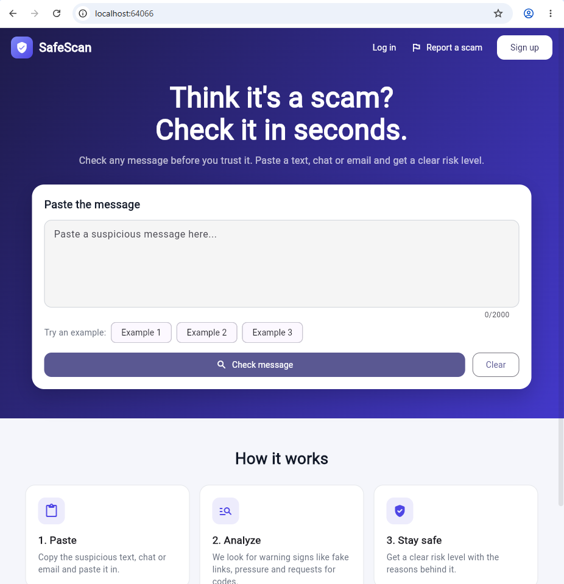
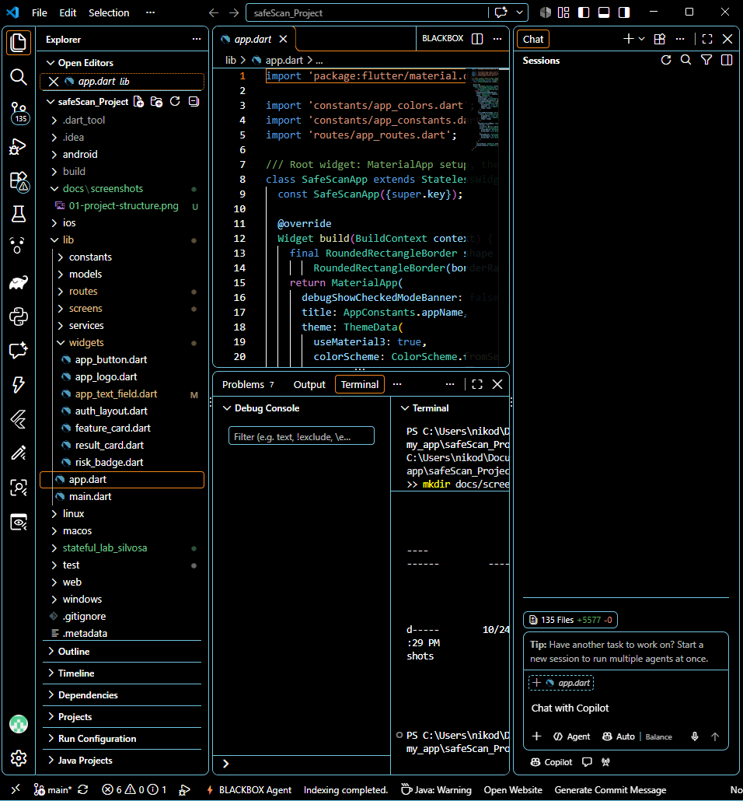
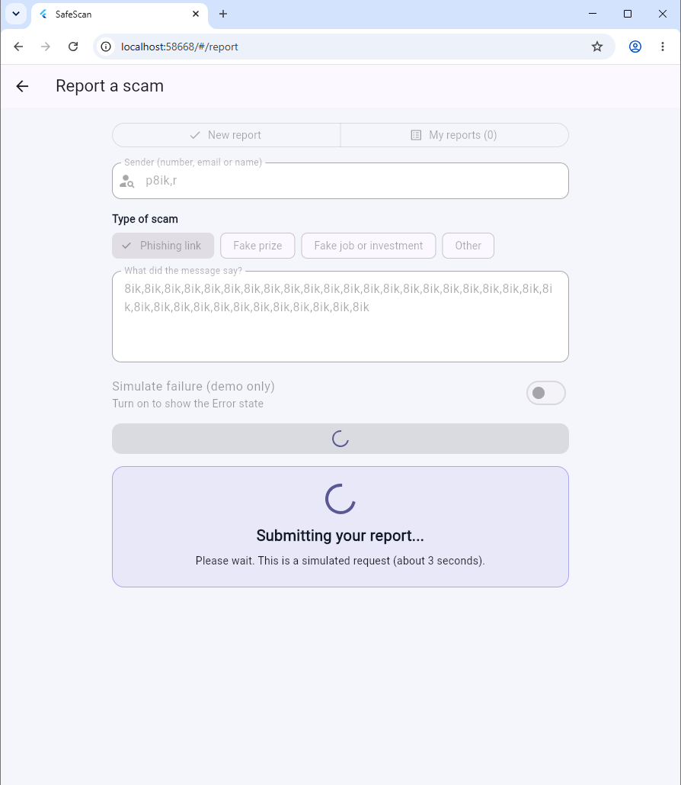
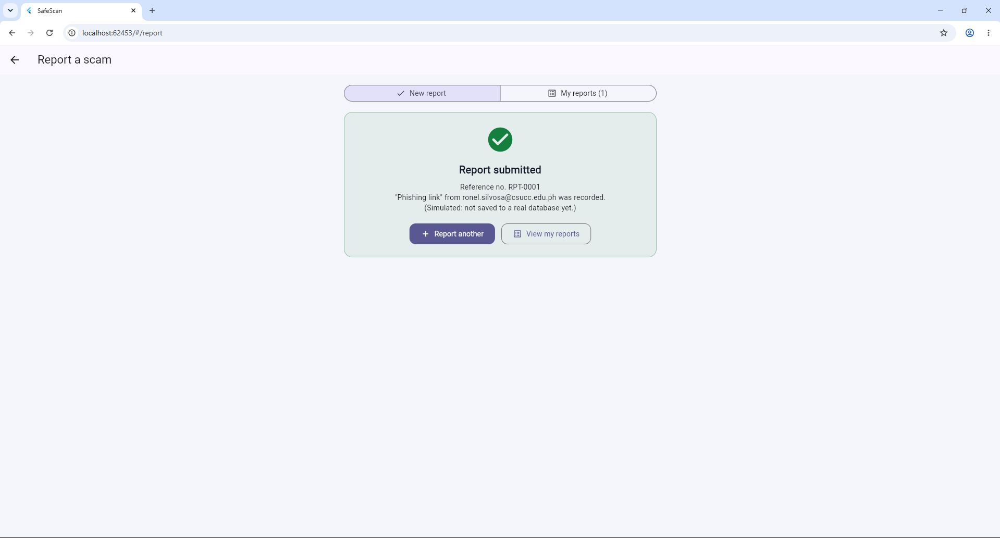
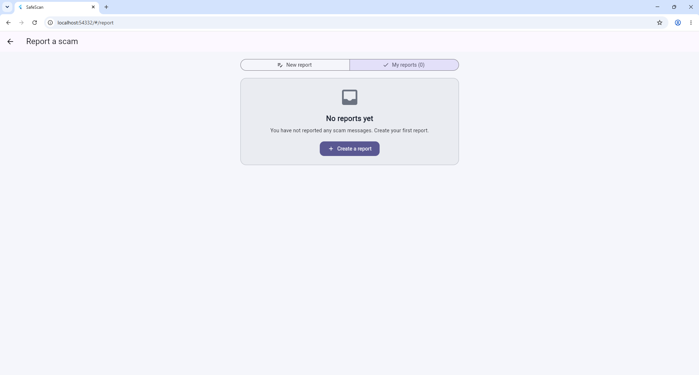
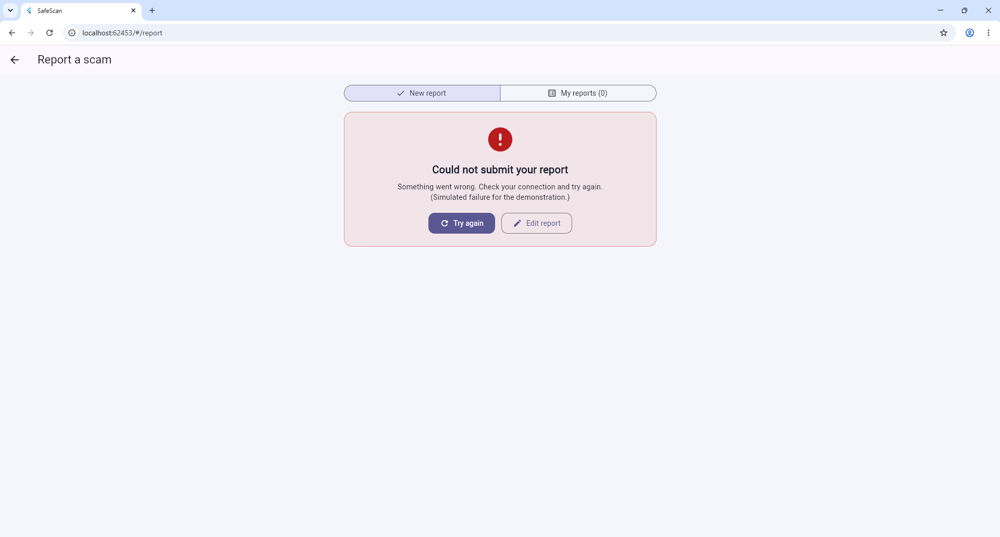

# ScamShield

## Summary
ScamShield: A Natural Language Processing-Based Suspicious Message
Classification and Risk Screening System for Messages. Users paste a
suspicious message and receive a risk screening (classification, risk level,
confidence, explanation). This first checkpoint contains only the Flutter Web
starter: Home (S-01 baseline) and Login (S-04 baseline) screens.

## Current stack
- Implemented: Flutter Web / Dart (starter UI, routing, reusable widgets)
- Planned (not implemented): FastAPI REST API, PostgreSQL

## Source layout (`lib/`)
- `main.dart` – entry point
- `app.dart` – MaterialApp, theme, routing setup
- `screens/` – Home, Login, Register, Report Form, Not Found
- `widgets/` – AppButton, AppTextField
- `services/` – future API client
- `models/` – client-side data models
- `routes/` – route names and generator
- `constants/` – app-wide constants (no secrets)

## Team
Ronel S. Silvosa

## First Checkpoint
Date: October 15, 2026 Commit: 113b29f

---

## Activity 9: Reusable Screens, Widgets, and Async UI States

**Author:** Ronel S. Silvosa  
**Repository:** https://github.com/ronelwar1/safeScan_Project

### Summary
Added a new **Report a scam** screen (`lib/screens/report_form_screen.dart`).
It has a form (sender, type of scam, message) with field validation, and it
shows four UI states for a simulated asynchronous request: Loading, Success,
Empty and Error. The screen is reached from the Home header link and from the
"Report a scam message" button on Home (route `/report`). The request is
**simulated** (a 3-second delay); there is no real backend yet.

---

### 1. Project structure
The new screen is the file `lib/screens/report_form_screen.dart`. The route `/report`
is registered in `lib/routes/app_routes.dart`.

---

### 2. Shared widget reused (`AppButton`)
The existing `AppButton` (`lib/widgets/app_button.dart`) is reused in the report form
and on the Home and Login screens instead of creating a new button.
`AppTextField` is reused for the form fields; it received optional `hint`, `minLines`,
`maxLines` and `enabled` parameters (Login and Register are unchanged).

---

### 3. Loading state
**Trigger:** enter a sender (3+ characters) and a message (10+ characters), then press
**Submit report**.  
**What happens:** the button shows a spinner and is disabled, the fields are locked, and a
"Submitting your report..." message appears for about 3 seconds. This prevents duplicate submissions.

---

### 4. Success state
**Trigger:** wait for the simulated request to finish.  
**What happens:** a green card shows the reference number (for example RPT-0001) with the
options **Report another** and **View my reports**.

---

### 5. Empty state
**Trigger:** open the **My reports** tab before submitting any report (or press **Clear all reports**).  
**What happens:** a "No reports yet" card appears with a **Create a report** button. This is
different from an error: nothing failed, there is simply nothing to show.

---

### 6. Error state
**Trigger:** turn on **Simulate failure (demo only)**, then press **Submit report**.  
**What happens:** after the wait, a red card says the submission failed, with **Try again**
and **Edit report**. Pressing **Try again** turns the failure off and the retry succeeds.

---

### Field validation
Pressing **Submit report** with empty fields, or with a message shorter than 10 characters,
shows an error under the field and does not start the request.

### Notes
- Implemented: Flutter Web UI with simulated async states.
- Planned (not implemented): FastAPI REST API and PostgreSQL storage.
- Commit for this activity: `Add report form and Flutter UI states` (add the commit hash after pushing).